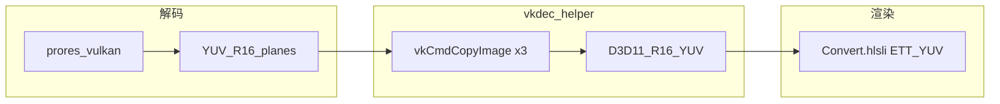
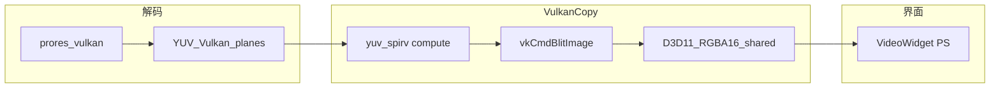

# ProRes Vulkan 硬解设计对比

本文对比 **GrandShowEE 3.8** 与本仓库 **ProResPlayer** 在 Windows 下通过 FFmpeg `prores_vulkan` 做 ProRes 播放硬加速、并把结果交给 Direct3D 11 显示的两套设计。范围仅限**播放解码与 DX11 呈现**，不含编码，也不讨论 NVDEC 或 Khronos Vulkan Video 里的 ProRes 解码操作（两侧均为 FFmpeg **Vulkan 计算着色器**：变长解码 + IDCT）。

**参考材料**

| 项目 | 文档 | 代码根目录 |
| --- | --- | --- |
| GrandShowEE 3.8 | `D:\code\EE3.7\GrandShowEE3.8\Document\ProRes\` 下《ProRes硬解码设计.md》《ProRes硬解码问题说明.md》 | `D:\code\EE3.7\GrandShowEE3.8\` |
| ProResPlayer | [开发文档.md](开发文档.md)、[development.md](development.md)、[README.md](../README.md) | 本仓库 `src/` |

---

## 摘要对比

| 维度 | GrandShowEE 3.8 | ProResPlayer（本仓库） |
| --- | --- | --- |
| FFmpeg | 8.1 full（libavcodec 62，见 GrandShow 设计 §3） | 9.0.2 full（见 README） |
| 进入 Vulkan 的 codec | 仅 `AV_CODEC_ID_PRORES`（`OpenVideoStreamVulkan`，设计 §2、§5） | `AV_CODEC_ID_PRORES` 与 `AV_CODEC_ID_PRORES_RAW`（`proresFamily`，`src/Player.cpp`） |
| hwaccel | `prores_vulkan`，帧 `AV_PIX_FMT_VULKAN` | 同上；RAW 侧为 `prores_raw_vulkan`（若构建启用） |
| Vulkan 设备 | `VulkanFactory` / `VulkanContext` 自建实例与设备，手写 `AVVulkanDeviceContext`、特性链、`qf[]`（设计 §6） | `findVulkanDeviceIndexByLuid` + `av_hwdevice_ctx_create`；`VulkanCopy` 复用 FFmpeg 已创建的 `VkDevice` |
| 设备门槛 | Vulkan 1.3、固定 Video 相关扩展、`VK_EXT_shader_object` 等；图形族 **≥2 个 queue** 否则硬解开不了（设计 §6.3、§11） | 依赖 FFmpeg 创建设备；零拷贝另需 `RGBA16Float` storage/blit 与 D3D 纹理导入探针（[开发文档](开发文档.md)） |
| 与 DX11 互操作 | Y/U/V 各一张 `DXGI_FORMAT_R16_UNORM`，`SHARED_NTHANDLE` + **Keyed Mutex** | 单张 `R16G16B16A16_UNORM`，`SHARED_NTHANDLE`，**无** Keyed Mutex |
| GPU 侧「交接」 | `vkCmdCopyImage` ×3，平面原样拷贝（`vkdec_helper.cpp`，设计 §7.3） | 自研 compute（`yuv_spirv.inc`）YUV→RGBA + `vkCmdBlitImage` 写入共享槽（`VulkanCopy.cpp`） |
| 色彩与位深 | **不在拷贝做**；DX11 `Convert.hlsli`，`textType == ETT_YUV`（×64/×16、Limited/Full、矩阵，设计 §8） | 在 Vulkan compute 的 push constants 与着色器中处理，再 blit 为 UNORM16 RGBA |
| 显示 | 三张 R16 SRV + 现有渲染管线 | `VideoWidget` 单 SRV 全屏像素着色器（`VideoWidget.cpp`） |
| 解码策略 | `DEC_AUTO` 打开失败 → CPU 软解；`DEC_HARDWARE` 失败不回退（§11） | 探测：软解 / Vulkan 回读 / Vulkan 零拷贝；零拷贝失败可降为 **回读**（仍 GPU 解码） |
| Alpha（硬解） | 不拷贝 A 平面，画面按不透明（设计 §14、问题说明 §1） | 元数据与着色器预留 alpha；零拷贝路径为单 RGBA 纹理，与 GrandShow 类似未接第四平面互操作 |
| 链接 Vulkan | 编译链接仓内 `vulkan-1.lib`（设计 §12） | 不显式链接 Vulkan SDK；互操作在 `VulkanCopy` 内动态 `vkGetDeviceProcAddr` |

---

## 数据流对比

两侧共同点：解码在同一 **DXGI LUID** 对应 GPU 上；FFmpeg 输出 `AVVkFrame` 多平面 `R16` 类图像；交接前需等待 **timeline semaphore**；D3D 通过 **NT 共享句柄** 与 Vulkan **外部内存导入** 使用同一块显存。

分叉点：GrandShow **保持平面 YUV** 进入既有渲染器；本仓库在 GPU 上 **合成 RGBA** 再交给简易交换链。

### GrandShowEE 3.8

依据《ProRes硬解码设计》§4、§7。

### ProResPlayer（Vulkan 零拷贝）

细节见 [开发文档.md](开发文档.md)「Vulkan 零拷贝设计」。回读路径为 `av_hwframe_transfer_data` → CPU BGRA → DX11 动态纹理，与 GrandShow 软解上传类似，此处不画图。

---

## FFmpeg 与解码入口

- **相同**：均使用 `avcodec_find_decoder` 的 `prores` 解码器 + `AV_HWDEVICE_TYPE_VULKAN` 设备上下文；硬解帧 `format == AV_PIX_FMT_VULKAN`；FFmpeg 内部 hwaccel 名为 `prores_vulkan`（GrandShow 问题说明 §2；本仓库 README）。
- **GrandShow**：`CVideoDecoder::OpenStream` 仅在 `codec_id == AV_CODEC_ID_PRORES` 时走 `OpenVideoStreamVulkan`；`AV_CODEC_ID_PRORES_RAW` **不**进入该路径（设计 §2、§14）。不按 profile 白名单，fourcc 与 `sw_format` 规则见设计 §2。
- **本仓库**：`proresFamily` 包含标准 ProRes 与 ProRes RAW；打开时 `probeDecodeMask` 对 ProRes 族尝试 Vulkan，并区分软解、回读、零拷贝（`src/Player.cpp`）。
- **版本差异**：GrandShow 锁定 FFmpeg **8.1** 与配套 `AVVulkanDeviceContext` 填法（`qf[]` 等）。本仓库使用 **9.0.2**；驱动对 `sw_format` 的 Vulkan 图像格式支持更敏感（README 中 422 LT `yuv422p10le` 与驱动 474/595 实测）。升级 FFmpeg 大版本时两侧都需核对 `hwcontext_vulkan` 字段与队列语义。

---

## Vulkan 设备与队列（工程差异最大）

### GrandShowEE 3.8

- 进程内 `VulkanFactory` 单例创建 **Vulkan 1.3** 实例，实例扩展与 `av_vk_get_optional_instance_extensions()` 求交（设计 §6.1）。
- `VulkanContext::init` 按渲染 `ID3D11Device` 的 **LUID** 选物理设备；`buildFixedDeviceExtensionList` 要求一批固定设备扩展（含 `VK_KHR_video_*` 等），缺一则换设备（设计 §6.2；代码 `VulkanContext.cpp`）。
- 图形族申请 **2 个 `VkQueue`** 时 `copyQueueIndex = 1`，拷贝提交到第二条队列，与 FFmpeg 使用的 queue 0 分离；仅 1 个 queue 时 `createVulkanHwDevice` **失败**（`VideoDecoder.cpp` 与 §6.3、§11）。
- `createVulkanHwDevice` 把特性链（timeline semaphore、shader object、8/16 bit storage 等）写入 `AVVulkanDeviceContext.device_features`，并填 `qf[]`、`user_opaque` 等（§6.4）。
- 工程 **链接 `vulkan-1.lib`**，运行依赖系统 `vulkan-1.dll`（§12）。

### ProResPlayer

- `findVulkanDeviceIndexByLuid` 临时建实例，用 `VkPhysicalDeviceIDProperties::deviceLUID` 匹配用户所选显卡，得到 FFmpeg 设备索引字符串（`Player.cpp`）。
- **`av_hwdevice_ctx_create`** 由 FFmpeg 创建与管理 `VkDevice`；无自管 `VulkanFactory`，无 Video 扩展固定门槛，**不要求**双图形队列。
- `VulkanCopy::init` 从 `AVHWDeviceContext` 取出已有 `VkDevice`，在同一 LUID 上再建 **独立** D3D11 设备用于共享纹理；通过 `vkGetDeviceProcAddr` 加载拷贝与互操作所需命令（[开发文档](开发文档.md)）。
- 零拷贝额外校验：`RGBA16Float` 的 storage/blit 能力及 16×16 共享纹理导入探针（`canImportSharedTexture`）。

**移植含义**：把 GrandShow 方案搬到小工具时，设备创建与队列配置成本高，但能与大型渲染器共用同一套 Vulkan 设备池。本仓库方案更轻，但零拷贝依赖驱动格式与 **自研 YUV→RGBA** 路径，与 GrandShow「只拷贝平面」假设不同。

---

## D3D11 互操作与纹理模型

| 项 | GrandShow | ProResPlayer |
| --- | --- | --- |
| 纹理数量与格式 | Y、U、V 三张 `R16_UNORM`（§7.1–7.2） | 每槽 1 张 `R16G16B16A16_UNORM` |
| 共享标志 | `SHARED_KEYEDMUTEX` \| `SHARED_NTHANDLE` | `SHARED` \| `SHARED_NTHANDLE` |
| Vulkan 操作 | 导入后 `vkCmdCopyImage`，格式与尺寸按平面（§7.3） | 导入后 compute + `vkCmdBlitImage` 到槽位 |
| 渲染采样 | `RenderHelper` / `BasePlayer`：绘制前 `AcquireSync(0)`（§7.4、§10） | `OpenSharedResource1` + SRV，无 keyed mutex |
| 缓冲复用 | 纹理回收池、按 `ID3D11Texture2D*` 缓存已导入 `VkImage` | 4 槽 `kSlots`，`busy` 原子 + `VideoFrame::slot` / `held[2]` 延长生命周期 |

GrandShow 的设计目标是 **接入已有平面 YUV 着色器**（`ETT_YUV`）。本仓库目标是 **独立播放器窗口**，用单 RGBA 纹理降低 `VideoWidget` 复杂度。

### GrandShow 为何采用 Y、U、V 三张 R16_UNORM

这不是「为了硬解单独发明」的格式，而是 **与 FFmpeg 输出、既有 D3D 软解路径、以及播控渲染器** 对齐后的自然结果。依据《ProRes硬解码设计》§2、§7、§8 与《ProRes硬解码问题说明》§5。

1. **与 `prores_vulkan` 帧布局一致**  
   FFmpeg 硬解后 `AV_PIX_FMT_VULKAN`，`AVVkFrame` 上 Y、U、V（及可选 A）各对应一张 **独立的** Vulkan 图像，软件侧格式为 `yuv422p10le` 等平面格式，Vulkan 侧映射为每张平面 **`VK_FORMAT_R16_UNORM`**，10/12 bit 有效值落在 16 bit 容器的低位（非 `G10X6` 左对齐打包）。GrandShow 用三张同格式、按平面宽高的 D3D 纹理，可以用 **`vkCmdCopyImage` 逐平面原样拷贝**，源与目标格式相同，无需在互操作阶段做 swizzle、缩放或矩阵。

2. **422/444 下平面尺寸不同**  
   U、V 相对 Y 按 `log2_chroma_w/h` 抽样（422 为半宽、全高等）。每张平面一张 2D 纹理，尺寸与 `vkdec_helper` 里三次拷贝的区域一一对应（设计 §7.1、§7.3）。若强行合成一张 RGBA 或打包纹理，要么在拷贝阶段做重采样/打包，要么浪费显存并改写整套采样逻辑。

3. **复用整机的平面 YUV 显示链路**  
   GrandShow 在 CPU 软解等路径上，早已通过 `cpudec_helper` 等把 **平面 `R16_UNORM`** 交给 `RenderHelper`，像素着色走 `Convert.hlsli` 的 **`textType == ETT_YUV`（`ETT_YUV`）**：`g_Tex0/1/2` 采样 Y/U/V，再乘 64/16 做位深展开、Limited/Full、BT.601/709/2020 矩阵（设计 §8）。硬解只需把 Vulkan 上的三张图 **换成 GPU 拷贝进来的三张同名纹理**，绘制常量与工程里保存的 `color_bit`、`color_space`、`color_range` 等元数据 **不用为 ProRes 另开一条 RGB 管线**。

4. **互操作阶段故意「只拷贝、不换算」**  
   问题说明 §5 明确：第一段互操作 **禁止** 在 Vulkan 里插 YUV→RGB 或位深转换着色器；否则与软解路径的亮度/矩阵行为容易分叉，且拷贝队列上多一次全屏 compute 增加与 FFmpeg 争用 GPU 的风险。位深与色彩 **统一留在第二段**——与软解共用的 `Convert.hlsli`，保证「同素材硬解/软解画面一致」的验收方式（设计 §15）。

5. **与纹理类型、Alpha 策略一致**  
   渲染端见 `DXGI_FORMAT_R16_UNORM` 即走 `ETT_YUV`；当前硬解 **不拷贝 A 平面**（设计 §14），画面按三平面不透明处理，与「没有 `TexWarpA`」的绘制分支一致。若将来要显示 4444 Alpha，设计上的增量是 **第四张 `R16_UNORM` + `ETT_YUVA`**，而不是改成单张 RGBA。

6. **和本仓库方案的对比**  
   ProResPlayer 没有 GrandShow 那套 `Convert.hlsli` / 多路合成渲染器，窗口只需一张可采样的 **显示用 RGBA**，因此在 `VulkanCopy` 里用 `yuv_spirv.inc` 做 YUV→RGBA，再 blit 到 **`R16G16B16A16_UNORM`** 共享纹理。GrandShow 选三张 R16，核心是 **最小侵入专业播控**；本仓库选单张 RGBA16，核心是 **独立播放器实现简单**。二者硬解前半段（FFmpeg `prores_vulkan`）相同，差异在 **交给 DX11 之前是否保持平面 YUV**。

---

## 色彩、位深与矩阵

- **GrandShow**：`vkdec_helper` 阶段 **禁止** 做 YUV→RGB 或位深缩放（问题说明 §5）。10/12 bit 在 `R16_UNORM` 采样后由 `Convert.hlsli` 乘 **64** 或 **16**，再 `conv_colorRange`、色度减 0.5、BT.601/709/2020 矩阵（设计 §8）。元数据来自 `CMedia::Load`（§9）。
- **ProResPlayer**：`yuv_spirv.inc` 在 **Vulkan compute** 中根据 `sw_format`、limited/full、`Push` 里的 black/mid/range/scale 写 `RGBA16Float`，再 blit 到共享 UNORM16（[开发文档](开发文档.md)「单帧 GPU 管线」「yuv_spirv.inc 的作用」）。`VideoWidget` 像素着色器主要做显示与 alpha 棋盘格，不承担完整 YUV 矩阵链路。

若要把 GrandShow 硬解接到只接受 RGBA 的渲染器，需要增加与本仓库类似的 GPU 转换阶段；若把本仓库接到 GrandShow 式 YUV 管线，应改为平面 `vkCmdCopyImage` + `Convert.hlsli`，而不是在 `VulkanCopy` 里合成 RGBA。

---

## 同步、线程与队列深度

- **GrandShow**：解码线程帧队列长度 **3**；拷贝在 `DealVideoData` / `vkdec_helper::FetchTexture` 路径，提交到 **copyQueue**，`vkWaitForFences` 后纹理才可给渲染；FFmpeg semaphore + fence；渲染与拷贝之间还有 **keyed mutex**（§5、§10）。
- **ProResPlayer**：解码 `std::thread`；界面 `QTimer` 约 15ms 取帧；`VulkanCopy::copy` 在提交链上挂接 FFmpeg timeline semaphore，**`vkQueueWaitIdle`** 后返回句柄；槽位释放由 `shared_ptr` 自定义析构触发（[开发文档](开发文档.md)）。

---

## 能力探测与失败回退

- **GrandShow**：打开阶段失败项见设计 §11（无 hwaccel、LUID/扩展/双队列、`av_hwdevice_ctx_init` / `avcodec_open2` 等）。`DEC_AUTO` → 软解；`DEC_HARDWARE` 不回退。打开成功后若 `vkdec_helper` 按路径 **Query** 不到 `VulkanContext`，该帧无硬解纹理，**不会**自动重开软解（§11）。
- **ProResPlayer**：`probeDecodeMask` 决定下拉框可选路径；`ProbeNote` 提示无 Vulkan 设备、创建设备失败、首帧非 Vulkan（驱动不支持 `sw_format` 等）。播放中 `VulkanCopy::copy` 失败会去掉零拷贝位并切换到 **Vulkan 回读**（`av_hwframe_transfer_data` + BGRA 上传），仍保留 GPU 解码（`Player.cpp` `handleVideo`）。

本仓库多出一档 **GPU 解码 + CPU 回读**，GrandShow 在硬解与 CPU 软解之间二分。

---

## 部署与依赖

- **GrandShow**：编译用仓内 Vulkan 头与 `vulkan-1.lib`、FFmpeg 导入库；播放机需驱动自带 `vulkan-1.dll` 及 §6 特性/扩展（问题说明 §4、设计 §12）。不捆绑 Loader。
- **ProResPlayer**：CMake + Qt 5.12 + `3rd/ffmpeg` DLL；不显式安装 Vulkan SDK；硬解可用性见 README「Vulkan 硬解环境」表。

---

## 代码索引

| 职责 | GrandShowEE 3.8 | ProResPlayer |
| --- | --- | --- |
| 选择 Vulkan / 打开解码器 | `CLT_Media/MMEngine/VideoDecoder.cpp` | `src/Player.cpp`（`open`、`probeDecodeMask`、`openDecoder`） |
| Vulkan 实例与设备 | `VulkanFactory.h`、`VulkanContext.cpp` | （FFmpeg）`av_hwdevice_ctx_create`；LUID 探测在同文件 `findVulkanDeviceIndexByLuid` |
| 帧到 DX11 | `vkdec_helper.cpp` | `VulkanCopy.cpp`、`VulkanCopy.h` |
| 颜色换算着色器 | `CLT_Media/D3DResource/HLSL/Convert.hlsli` | `src/yuv_spirv.inc`（compute）+ `VideoWidget` 内建 PS |
| 渲染同步 | `GrandShow/PlayControl/RenderPlayer/BasePlayer.cpp` 等 | `src/VideoWidget.cpp`（`present` / `drawFrame`） |
| 播放调度 | `CLT_Media/MMEngine/Player.cpp`（`DealVideoData`） | `src/MainWindow.cpp`（`onTick`） |

---

## 设计取舍小结

- **GrandShowEE 3.8**：嵌入专业播控与 D3D 资源体系；硬解输出 **三张平面 R16**，与软解上传、其他素材的 YUV 着色器 **统一**；为此承担完整的 Vulkan 1.3 设备栈、Video 扩展门槛与 **双队列** 拷贝隔离。
- **ProResPlayer**：独立演示/工具型播放器；对用户暴露 **三种解码路径** 与显卡选择；零拷贝用 **单 RGBA16 共享纹理** 简化 UI，在 GPU 上完成 YUV→RGBA，设备创建 largely 委托 FFmpeg 9.x。
- **互借建议**  
  - 需要对接 GrandShow 或同类 **平面 YUV** 渲染器：优先参考 `vkdec_helper` + `Convert.hlsli`，不要在拷贝阶段做 RGB 合成。  
  - 需要 **轻量窗口播放器** 或快速验证 FFmpeg 9.x 与驱动格式：参考 `VulkanCopy`、`probeDecodeMask` 与 [开发文档](开发文档.md)。

---

## 相关链接

- 本仓库 Vulkan 零拷贝专章：[开发文档.md](开发文档.md)  
- 本仓库简要说明：[development.md](development.md)  
- GrandShow 详细设计（外部路径）：`Document\ProRes\ProRes硬解码设计.md`  
- GrandShow 常见问题（外部路径）：`Document\ProRes\ProRes硬解码问题说明.md`
