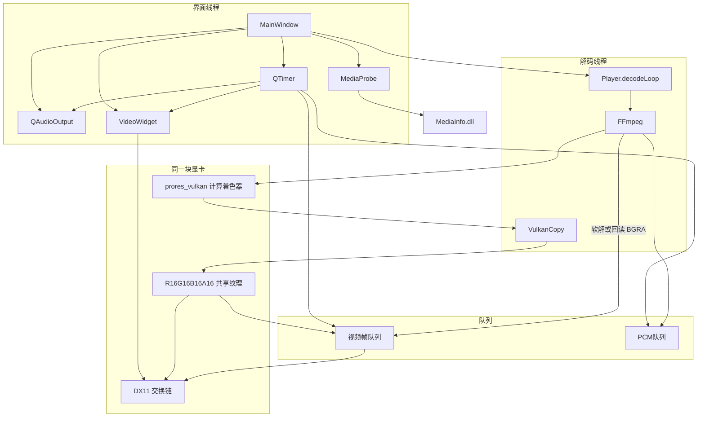
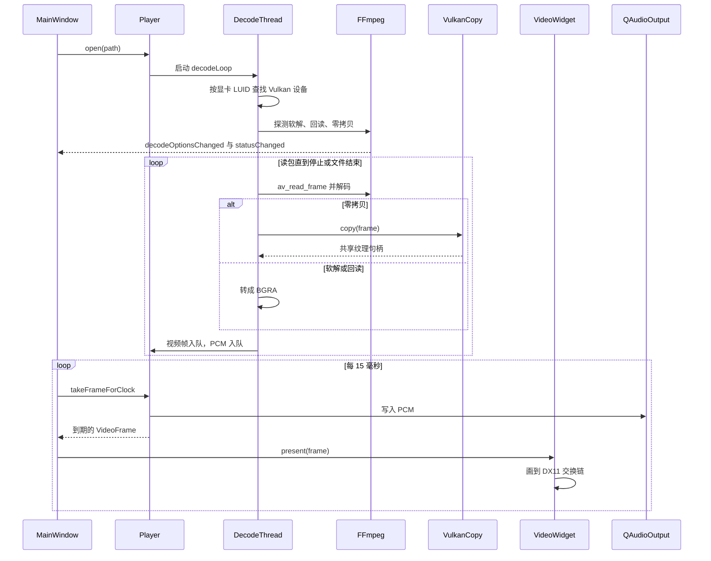
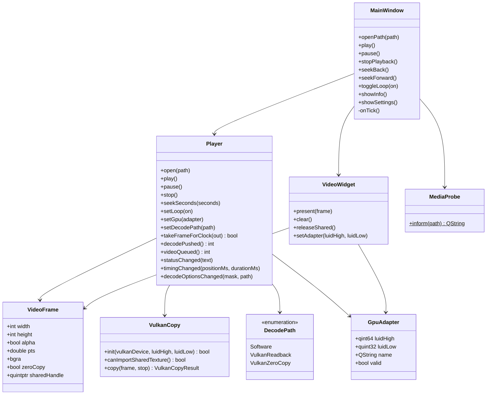
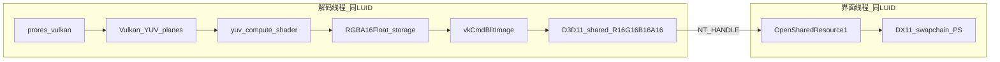
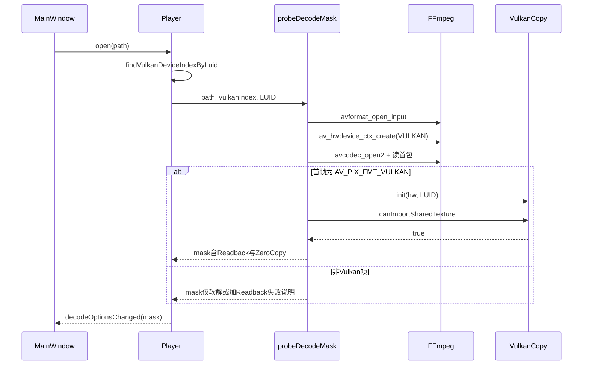
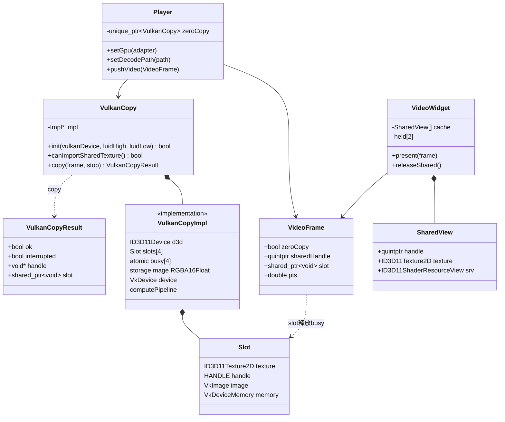

# 开发文档

当前播放器的模块划分、一次打开并播放的时序、主要类的关系，以及 Vulkan 零拷贝专章。实现细节见 [development.md](development.md)。

## 设计架构

界面线程拥有窗口、定时器和声卡。解码使用 `std::thread`，不使用 `QThread`。软解和 Vulkan 回读把 BGRA 放进队列；零拷贝由 `VulkanCopy` 写成共享纹理，像素不回到 CPU。`VideoWidget` 用同一块显卡的 DX11 交换链画画面。`MediaProbe` 只在点击「文件信息」时加载 `MediaInfo.dll`。



## 运行时序

下面是一次打开并持续播放。探测只保留成功的路径，默认优先零拷贝，其次回读，最后软解。音频时钟超过约 150 毫秒不前进时，出帧改用经过的时间。窗口缩放时，`VideoWidget` 用上一帧重画新的交换链。



## 类图

只画出对外方法和信号。`Player` 与 `VideoWidget` 的私有 `Engine`、`Impl` 不展开。



## Vulkan 零拷贝设计

总览见上文「设计架构」。本节只展开 **Vulkan 零拷贝** 路径：不是 NVDEC，解码由 FFmpeg 9.0.2 的 `prores_vulkan` 计算着色器产出 `AV_PIX_FMT_VULKAN` 帧；显示仍用 DX11 交换链。二者必须在 **同一块 DXGI 适配器** 上，通过 **D3D11 共享 NT 句柄** 与 **Vulkan 外部内存导入** 衔接，全程不把像素读回 CPU。驱动是否接受素材的 `sw_format` 见 [README.md](../README.md) 中 Vulkan 硬解环境与档位表；线程与画面总述见 [development.md](development.md)。

### 设计目标与约束

- **目标**：解码线程在 GPU 上完成 ProRes 解包与 YUV→可显示 RGBA，写入可与 DX11 共享的 `R16G16B16A16_UNORM` 纹理；界面线程只 `OpenSharedResource1` 并采样，队列里不传 `bgra`。
- **约束**：`VulkanCopy` 与 `VideoWidget` 的 D3D11 设备、FFmpeg 的 Vulkan 物理设备，都必须对应设置里所选 `GpuAdapter` 的 LUID。
- **降级**：运行时 `VulkanCopy::copy` 失败会去掉零拷贝选项并切换到 Vulkan 回读（`av_hwframe_transfer_data` + CPU 侧 BGRA 上传），见 `src/Player.cpp` 中 `handleVideo`。
- **中断**：`copy` 在停止、暂停或 seek 挂起时通过 `stop` 回调返回 `interrupted`，不入队。

### 同 GPU 对齐

1. 用户在设置中选择显卡 → `Player::setGpu` 保存 `luidHigh` / `luidLow`。
2. 打开文件前，`findVulkanDeviceIndexByLuid` 临时创建 Vulkan 实例（启用 `VK_KHR_get_physical_device_properties2` 等），用 `VkPhysicalDeviceIDProperties::deviceLUID` 与 DXGI LUID 比对，得到 FFmpeg 用的设备索引字符串。
3. `av_hwdevice_ctx_create(..., AV_HWDEVICE_TYPE_VULKAN, index, ...)` 与正式播放时 `openDecoder` 使用同一索引。
4. `VulkanCopy::init` 从 FFmpeg 的 `AVHWDeviceContext` 取出已创建的 `VkDevice`，再 `openD3d(luidHigh, luidLow)` 在该适配器上创建 **独立的** D3D11 设备（与 `VideoWidget` 的 DX11 设备并列，但 LUID 相同）。
5. `VideoWidget::setAdapter` 保证交换链与 `OpenSharedResource1` 落在同一适配器。

### 能力与探测

打开素材时 `probeDecodeMask`（仍在界面/解码协调路径上，逻辑在 `Player.cpp`）：

| 步骤 | 结果 |
| --- | --- |
| 能打开视频流 | `mask` 含软解 |
| ProRes 且找到 LUID 对应 Vulkan 设备 | 创建 `hw_device_ctx`，`avcodec_open2` |
| 读到首帧且 `format == AV_PIX_FMT_VULKAN` | `mask` 含 Vulkan 回读 |
| `VulkanCopy::init(hw, luid)` 且 `canImportSharedTexture()` | `mask` 含零拷贝 |

`init` 额外检查：`RGBA16Float` 支持 storage 与 blit 源、`RGBA16Unorm` 支持 blit 目标。`canImportSharedTexture` 创建 16×16 共享纹理、尝试 `importHandle`，成功则销毁探针资源并返回 true。

探测失败时的 `ProbeNote`：无 Vulkan 设备、设备创建失败、或驱动不接受像素格式导致首帧不是 Vulkan 帧。

### 纹理、槽位与生命周期

- **共享纹理（每槽）**：D3D11 `CreateTexture2D`，格式 `DXGI_FORMAT_R16G16B16A16_UNORM`，`D3D11_RESOURCE_MISC_SHARED \| D3D11_RESOURCE_MISC_SHARED_NTHANDLE`，`CreateSharedHandle` 得到 NT 句柄。
- **Vulkan 导入**：`VkImage` 格式 `VK_FORMAT_R16G16B16A16_UNORM`，外部句柄类型 `VK_EXTERNAL_MEMORY_HANDLE_TYPE_D3D11_TEXTURE_BIT`，`vkGetMemoryWin32HandlePropertiesKHR` 选内存类型后 `vkAllocateMemory` 导入并 `vkBindImageMemory`。
- **槽位池**：`kSlots = 4`。每槽有 `busy[i]`（`atomic<int>`，0 空闲 / 1 占用）。`copy` 自旋抢空闲槽（约 2ms 间隔），录完命令并 `vkQueueWaitIdle` 后把句柄交给 `VideoFrame`；`result.slot` 是带自定义析构的 `shared_ptr`，析构时 `busy` 置 0。
- **中间资源**：与分辨率绑定的 `RGBA16Float` `storageImage`（计算着色器输出）；缺省平面用的 1×1 `dummyImage`（R16 填白）。分辨率变化时重建 storage 与四个槽的 D3D/Vulkan 图像。
- **界面侧**：`VideoFrame::slot` 与 `VideoWidget` 的 `held[0/1]` 交替持有上一帧/当前帧的 `slot`，避免 DX11 仍在采样时解码线程复用同一槽。

### 单帧 GPU 管线

实现集中在 `src/VulkanCopy.cpp` 与内嵌 SPIR-V `src/yuv_spirv.inc`。

1. 从 `AVFrame` 的 `data[0]` 解析 `AVVkFrame`（文档内称 `FrameView`，布局与 FFmpeg 一致）。
2. 按 `hw_frames_ctx->sw_format` 用 `av_vkfmt_from_pixfmt` 为各平面建临时 `VkImageView`（多平面或单图多 aspect）。
3. **Barrier** 将解码器输出的布局转为 `SHADER_READ_ONLY`，storage 转为 `GENERAL` 可写。
4. **计算着色器**：4 个 combined image sampler（平面或 dummy）+ 1 个 `RGBA16Float` storage image；push constants 携带宽高、色度抽样、alpha 标志、位深与 limited/full range 的 black/mid/range/scale。
5. `dispatch` 按 8×8 线程组覆盖画面。
6. **Blit** 从 `storageImage`（`TRANSFER_SRC`）到当前槽的导入 image（`TRANSFER_DST`），再 barrier 到 `GENERAL` 供后续采样语义一致。
7. **同步**：若帧上带有 FFmpeg Vulkan 的 timeline semaphore，在 `VkSubmitInfo` 链 `VkTimelineSemaphoreSubmitInfo` 等待/信号；提交后 `vkQueueWaitIdle`，更新 `semValue`，保证 D3D 打开句柄时 GPU 已完成写入。

### yuv_spirv.inc 的作用

`src/yuv_spirv.inc` 不是 FFmpeg 自带的 `prores_vulkan` 解码着色器，而是 **本播放器零拷贝显示链路** 里用的 **YUV→RGBA 计算着色器** 的 SPIR-V 字节码。文件内容是 `uint32_t` 字面量列表（首字 `0x07230203` 为 SPIR-V 魔数），在 `VulkanCopy.cpp` 里通过 `#include` 拼进静态数组 `kSpirv[]`，再交给 `vkCreateShaderModule` 创建模块，入口名为 `main`，与 `pipelineReady()` 里创建的 compute pipeline 绑定。

**在管线中的位置**：`prores_vulkan` 在 GPU 上解出 ProRes，输出仍是 Vulkan 上的 YUV 多平面图像（`sw_format` 如 `yuv422p10le`）。DX11 只能直接采样打包好的 `R16G16B16A16_UNORM` 共享纹理，因此需要额外一步把解码帧 **转成可显示的 RGBA**。`yuv_spirv.inc` 对应的就是这一步；之后的 `vkCmdBlitImage` 再把 `RGBA16Float` 暂存图写入与 D3D 共享的 `RGBA16Unorm` 槽位。

**与 C++ 侧的约定**（修改着色器时必须一并改 `VulkanCopy.cpp`）：

| 项目 | 约定 |
| --- | --- |
| 描述符集 | binding 0～3：`combined image sampler`，采样 Y/U/V/A 平面（不足 4 平面时用 1×1 dummy 纹理） |
| | binding 4：`RGBA16Float` storage image，写入转换结果 |
| Push constants | 40 字节，对应 `Push`：`w`、`h`、色度 `log2_chroma_w/h`、`hasAlpha`、`scale`（10/12 bit 归一）、`black`/`mid`/`range`/`alphaMax`（limited 与 full range） |
| 调度 | `dispatch((w+7)/8, (h+7)/8, 1)`，按 8×8 线程组覆盖像素 |

**维护方式**：仓库内 **没有** 对应的 `.glsl` / `.comp` 源文件，只有编译好的 `.inc`。若要改色彩矩阵、alpha 或采样逻辑，需在外部用 `glslangValidator` 等工具把 GLSL 编译为 SPIR-V，再导出为同样的 `uint32_t` 数组替换 `yuv_spirv.inc`，并确认描述符布局与 `Push` 大小仍与 `pipelineReady()`、`copy()` 中的 `writeSets` / `pushConst` 一致。

### 零拷贝数据通路

同 LUID；像素路径不经过 CPU。



### 探测时序

与上文「运行时序」中 open 阶段对应；下图只写路径发现，不写 15ms 播放循环。



### 单帧转写与入队

播放循环中零拷贝分支；界面 `present` 仍由主窗口 `onTick` 驱动，见「运行时序」。

```mermaid
sequenceDiagram
    participant Loop as decodeLoop
    participant FF as FFmpeg
    participant VC as VulkanCopy
    participant Q as videoQueue
    participant VW as VideoWidget

    Loop->>FF: avcodec_receive_frame
    FF-->>Loop: AV_PIX_FMT_VULKAN
    Loop->>VC: copy(frame, stop)
    VC->>VC: 抢空闲slot
    VC->>VC: 录命令缓冲_submit_waitIdle
    VC-->>Loop: ok, handle, slot
    Loop->>Q: pushVideo(zeroCopy, handle, slot)
    Note over VW: 另一线程
    VW->>VW: held保留slot
    VW->>VW: OpenSharedResource1(handle)
    VW->>VW: PS采样并Present
    Note over VC,VW: slot析构后busy释放，槽可复用
```

### 界面呈现

- 队列中的 `VideoFrame`：`zeroCopy == true`，`sharedHandle` 为 NT 句柄，`bgra` 为空。
- `drawFrame` 按句柄缓存 `SharedView`（texture + SRV），避免每帧重复创建。
- 像素着色器与软解路径共用全屏四边形；常量缓冲区分是否带 alpha（棋盘格底）。
- 窗口缩放时 `resizeSwapChain` 用 `d->last` 重画，零拷贝帧同样依赖缓存的 SRV 或句柄表。

### 失败与中断

| 场景 | 行为 |
| --- | --- |
| 探测阶段无法导入共享纹理 | 下拉框无「Vulkan 零拷贝」，仅回读/软解 |
| 播放中 `copy` 失败 | 清除 `kPathZeroCopy`，切 Vulkan 回读并 `publish` |
| `copy` 时 stop/seek/pause | `interrupted`，丢弃本帧 |
| 驱动不支持 `sw_format` | FFmpeg 不出 Vulkan 帧，探测 note `FrameNotVulkan` |

### 零拷贝相关类图

`VulkanCopy::Impl` 仅在 `VulkanCopy.cpp` 内实现，头文件不导出；下图用于说明协作关系。


