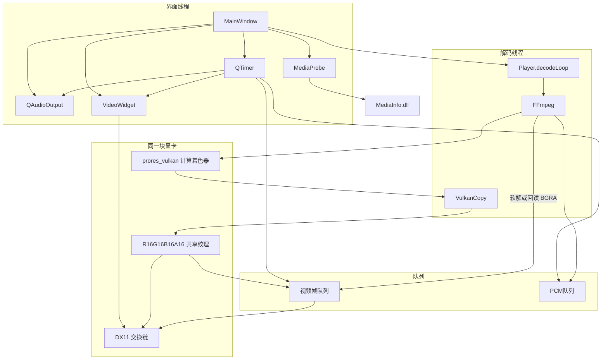
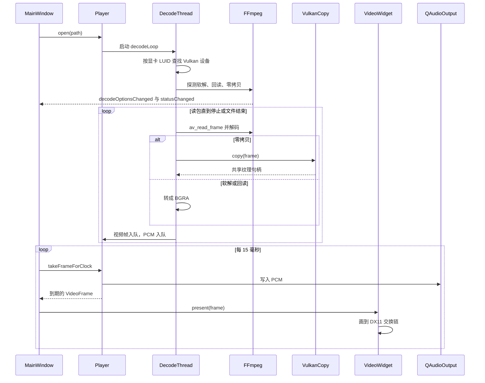
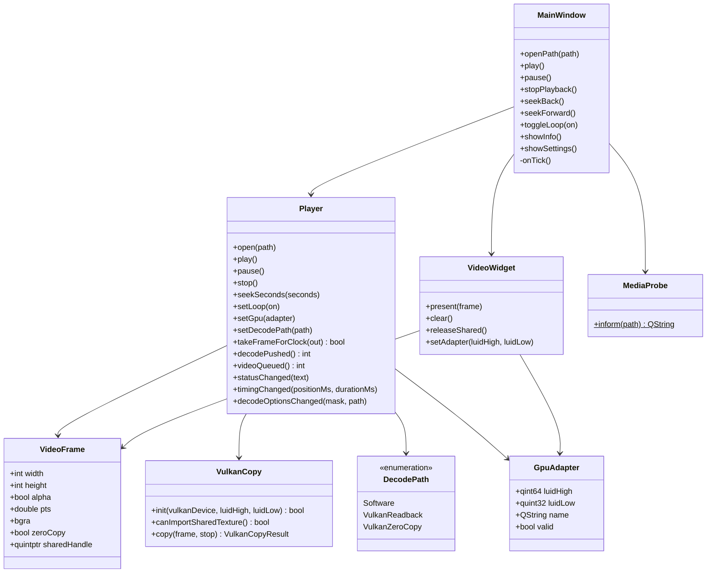

# 开发文档

当前播放器的模块划分、一次打开并播放的时序，以及主要类的关系。实现细节见 [development.md](development.md)。

## 设计架构

界面线程拥有窗口、定时器和声卡。解码使用 `std::thread`，不使用 `QThread`。软解和 Vulkan 回读把 BGRA 放进队列；零拷贝由 `VulkanCopy` 写成共享纹理，像素不回到 CPU。`VideoWidget` 用同一块显卡的 DX11 交换链画画面。`MediaProbe` 只在点击「文件信息」时加载 `MediaInfo.dll`。

## 运行时序

下面是一次打开并持续播放。探测只保留成功的路径，默认优先零拷贝，其次回读，最后软解。音频时钟超过约 150 毫秒不前进时，出帧改用经过的时间。窗口缩放时，`VideoWidget` 用上一帧重画新的交换链。

## 类图

只画出对外方法和信号。`Player` 与 `VideoWidget` 的私有 `Engine`、`Impl` 不展开。

